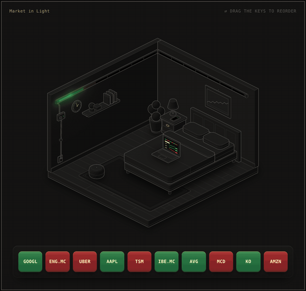
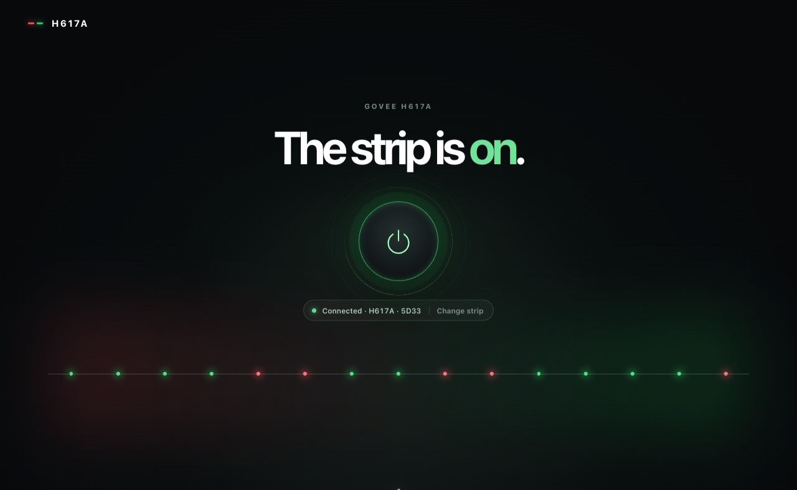
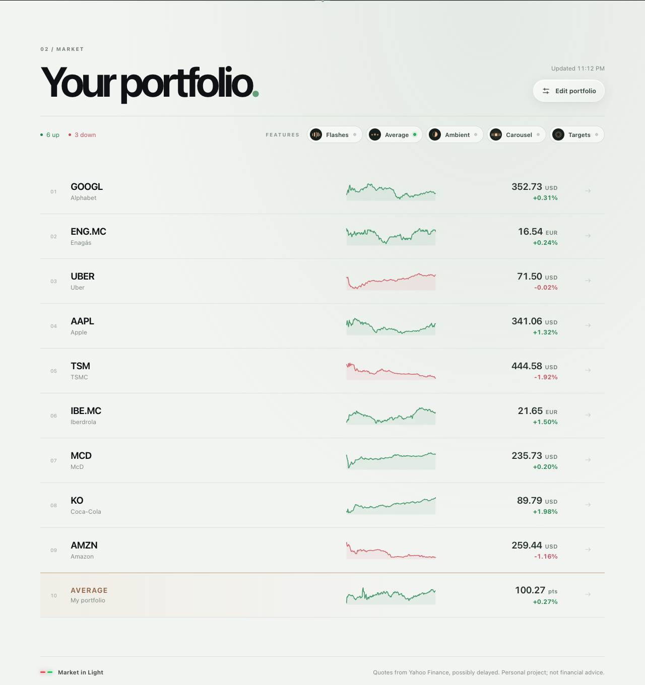
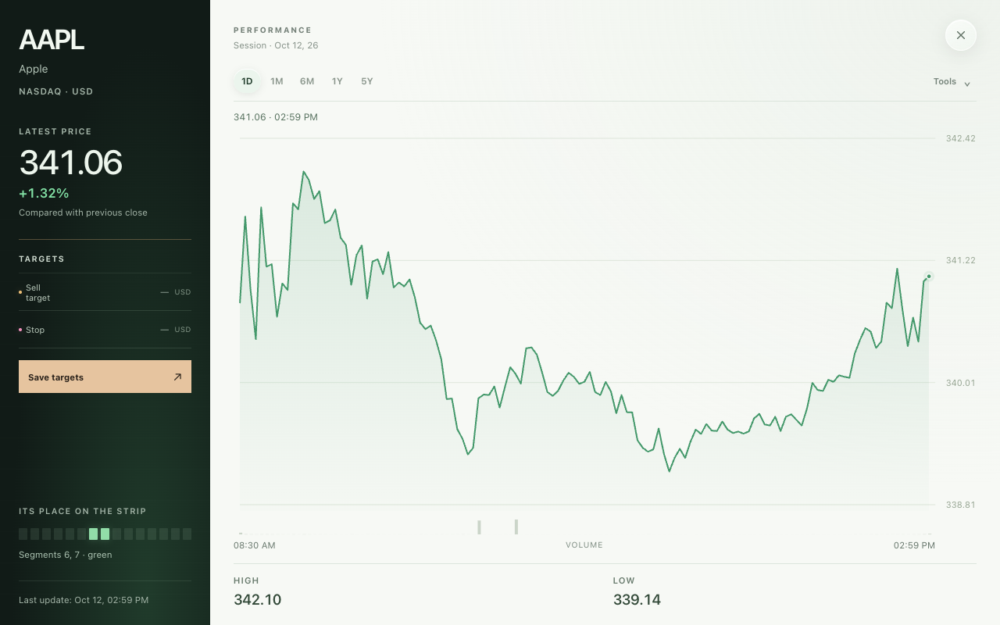
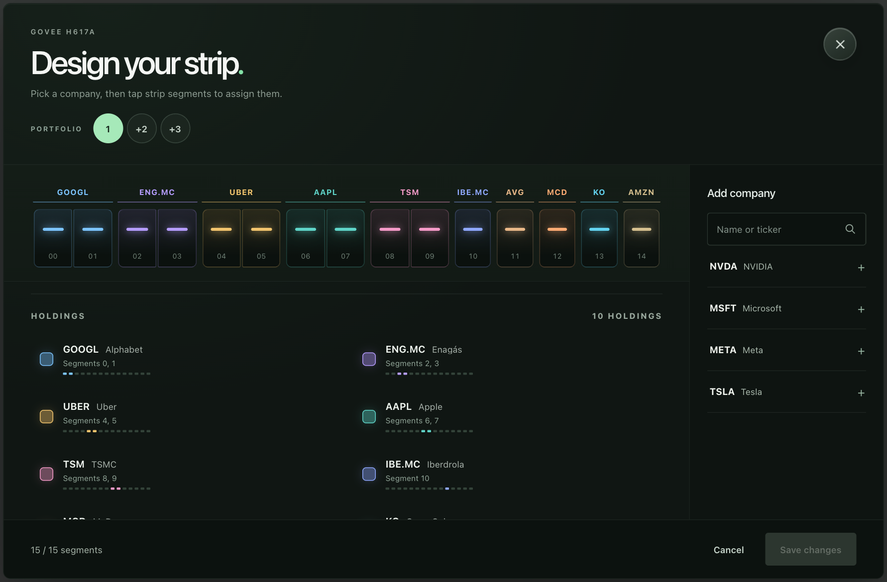
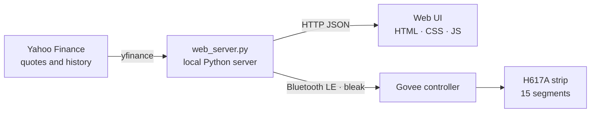

<div align="center">

# Mercado en Luz · Market in Light

**Your stock portfolio, glowing on the wall.**
A local web app that turns each company of a portfolio into a green or red stretch of light on a Govee LED strip, over Bluetooth.

[](https://github.com/Marco-Garcia-G/proyecto-mercado-en-luz/actions/workflows/tests.yml)


[](LICENSE)

[**▶ Try the interactive demo**](https://marco-garcia-g.github.io/proyecto-mercado-en-luz/) · [Leer en español](docs/README.es.md)

<a href="https://marco-garcia-g.github.io/proyecto-mercado-en-luz/"></a>

<sub>No strip at hand? The demo above recreates the setup in the browser: tap a key to flash a company, drag keys to rearrange the strip.</sub>

</div>

---

## The web app

The core of the project is a dashboard served from your Mac. It reads live quotes, draws the portfolio and keeps the strip in sync. Every segment of the strip is a company: **green** when it is up on the day, **red** when it is down.

<table>
  <tr>
    <td width="50%"></td>
    <td width="50%"></td>
  </tr>
  <tr>
    <td><b>Power and connection.</b> One button switches the strip; the status line shows every Bluetooth step (searching, connecting, confirming, connected) and explains failures with a fix.</td>
    <td><b>Portfolio.</b> Price, daily change and intraday sparkline for each holding, plus a strip preview that mirrors the real LEDs.</td>
  </tr>
  <tr>
    <td></td>
    <td></td>
  </tr>
  <tr>
    <td><b>Interactive charts.</b> 1D to 5Y, 200-day average, dividends, drawing tools and keyboard navigation.</td>
    <td><b>Strip editor.</b> Search US and Madrid stocks, assign segments by tapping or dragging, keep three saved portfolios.</td>
  </tr>
</table>

### Features

- **Live portfolio on light.** Quotes refresh every minute, last known prices survive restarts, and the strip only receives a packet when a colour actually changes.
- **Flashes.** When a company crosses ±1–5 % its stretch blinks once per threshold and session (1 % = 1 second of light).
- **Portfolio average.** One segment can show the equal-weight or custom-weighted average of the whole portfolio.
- **Ambient.** Dims the strip at night or on a schedule, and scales brightness with the size of the move.
- **Carousel.** Cycles a longer watchlist across the 15 segments.
- **Targets.** Sell and stop prices per company turn its stretch amber or magenta when reached.
- **Works with any H617A.** The first launch scans for nearby strips, picks the strongest signal and remembers it; a stale strip is forgotten and found again automatically.
- **Bilingual.** Spanish and English interfaces, chosen from the browser language.
- **Phone access.** `--lan` serves the same page to phones on the home Wi-Fi.

## How it works



Each colour is sent as one 20-byte segment packet, so a whole portfolio updates in a handful of writes:

```text
33 05 15 01  RR GG BB  00 00 00 00 00  MM MM  00 00 00 00 00  XX
└ command ┘  └ colour ┘                └mask ┘                 └ XOR checksum
```

The mask has one bit per segment, the checksum is the XOR of the first 19 bytes, and every power change is confirmed by reading the strip's state back before the UI says it changed.

## Getting started

Requirements: macOS with Bluetooth, Python 3.10 or newer and a Govee H617A strip (other segmented Govee models are in beta).

```bash
git clone https://github.com/Marco-Garcia-G/proyecto-mercado-en-luz.git
cd proyecto-mercado-en-luz/app
pip install -r requirements.txt
python3 web_server.py
```

The page opens at `http://127.0.0.1:8765`. On first launch the server copies `config.example.json` to `config.json` (your own portfolio, kept out of Git) and searches for the strip. macOS asks once for Bluetooth permission for the app running the server, such as Terminal or VS Code.

Run `python3 web_server.py --lan` to open the dashboard from a phone on the same network. The detailed Spanish user manual is in [docs/manual-es.md](docs/manual-es.md).

## Native apps

The same interface also ships inside two native shells that talk to the strip directly, without the Mac:

| Platform | Stack | Notes |
| --- | --- | --- |
| iPhone, iPad and Mac Catalyst | Swift, Core Bluetooth, WKWebView | Background refresh and Bluetooth state restoration. [ios/](ios/README.md) |
| Android | Java, BluetoothGatt, WebView | Foreground service that keeps quotes and the strip updated with the screen off. [android/](android/README.md) |

## Project structure

```text
app/                 The web app
├─ web_server.py     Local server: quotes, history, search, portfolio and Bluetooth sessions
├─ market_govee.py   Strip protocol, discovery, colour masks and a terminal-only monitor
├─ pro_features.py   Average, ambient, targets and their validation
├─ web/              Dashboard (Spanish at /, English at /en/)
└─ tests/            Unit tests (protocol, discovery, server logic)
ios/  android/       Native apps reusing app/web/
docs/                Interactive demo, screenshots and the Spanish manual
```

## Tests

```bash
cd app && python3 -m unittest discover -s tests -v
```

The suite runs without hardware or network: Bluetooth and Yahoo Finance are mocked. It also runs on every push through GitHub Actions.

## Data and disclaimer

Quotes come from Yahoo Finance through the open-source `yfinance` library, for personal and non-commercial use; they may be delayed and this project is not financial advice. Mercado en Luz is an independent project and is not affiliated with Govee or Yahoo.

## License

[MIT](LICENSE) © Marco García González
