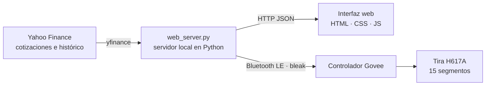

<div align="center">

# Mercado en Luz

**Tu cartera de bolsa, iluminando la pared.**
Una web local que convierte cada empresa de una cartera en un tramo de luz verde o roja sobre una tira LED Govee, por Bluetooth.

[](https://github.com/Marco-Garcia-G/proyecto-mercado-en-luz/actions/workflows/tests.yml)


[](../LICENSE)

[**▶ Prueba la demo interactiva**](https://marco-garcia-g.github.io/proyecto-mercado-en-luz/figure/market-in-light-es.html) · [Read in English](../README.md)

<a href="https://marco-garcia-g.github.io/proyecto-mercado-en-luz/figure/market-in-light-es.html"></a>

<sub>¿Sin tira a mano? La demo recrea el montaje en el navegador: toca una tecla para que destelle una empresa y arrastra las teclas para reordenar la tira.</sub>

</div>

---

## La web

El corazón del proyecto es un panel que se sirve desde el Mac. Lee las cotizaciones, dibuja la cartera y mantiene la tira sincronizada. Cada segmento es una empresa: **verde** si sube en el día y **rojo** si baja.

<table>
  <tr>
    <td width="50%"></td>
    <td width="50%"></td>
  </tr>
  <tr>
    <td><b>Encendido y conexión.</b> Un botón enciende la tira; el indicador muestra cada paso del Bluetooth (buscando, conectando, comprobando, conectada) y explica los fallos con su solución.</td>
    <td><b>Cartera.</b> Precio, variación diaria y minigráfico de cada empresa, con una vista previa que replica los LED reales.</td>
  </tr>
  <tr>
    <td></td>
    <td></td>
  </tr>
  <tr>
    <td><b>Gráficos interactivos.</b> De 1D a 5A, media de 200 sesiones, dividendos, herramientas de dibujo y navegación con teclado.</td>
    <td><b>Editor de la tira.</b> Busca acciones de EE. UU. y Madrid, asigna segmentos tocando o arrastrando y guarda tres carteras.</td>
  </tr>
</table>

### Funciones

- **La cartera, en luz.** Las cotizaciones se renuevan cada minuto, los últimos precios se conservan entre reinicios y la tira solo recibe un paquete cuando un color cambia de verdad.
- **Destellos.** Cuando una empresa cruza ±1–5 %, su tramo parpadea una vez por umbral y sesión (1 % = 1 segundo de luz).
- **Media de la cartera.** Un segmento puede mostrar la media equiponderada o ponderada de toda la cartera.
- **Ambiente.** Atenúa la tira de noche o por horario y ajusta el brillo a la fuerza del movimiento.
- **Carrusel.** Recorre una lista más larga de empresas por los 15 segmentos.
- **Objetivos.** Precios de venta y stop por empresa que tiñen su tramo de ámbar o magenta al alcanzarse.
- **Funciona con cualquier H617A.** La primera vez busca las tiras cercanas, elige la de mejor señal y la recuerda; si deja de aparecer, la olvida y la vuelve a buscar.
- **Bilingüe.** Interfaz en español e inglés según el idioma del navegador.
- **Desde el móvil.** `--lan` sirve la misma página a los móviles de la Wi-Fi de casa.

## Cómo funciona



Cada color se envía como un paquete de segmento de 20 bytes, así que una cartera entera se actualiza con unas pocas escrituras:

```text
33 05 15 01  RR GG BB  00 00 00 00 00  MM MM  00 00 00 00 00  XX
└ comando ┘  └ color ┘                 └máscara┘               └ XOR de control
```

La máscara tiene un bit por segmento, el byte de control es el XOR de los 19 anteriores, y cada encendido o apagado se confirma leyendo el estado de la tira antes de mostrarlo en la interfaz.

## Puesta en marcha

Necesitas macOS con Bluetooth, Python 3.10 o posterior y una tira Govee H617A (otros modelos segmentados de Govee están en beta).

```bash
git clone https://github.com/Marco-Garcia-G/proyecto-mercado-en-luz.git
cd proyecto-mercado-en-luz/app
pip install -r requirements.txt
python3 web_server.py
```

La página se abre en `http://127.0.0.1:8765`. La primera vez, el servidor copia `config.example.json` a `config.json` (tu cartera, que no se sube a Git) y busca la tira. macOS pide una vez permiso de Bluetooth para la app desde la que ejecutas el servidor, como Terminal o VS Code.

Con `python3 web_server.py --lan` puedes abrir el panel desde un móvil en la misma red. El manual de uso completo está en [docs/manual-es.md](manual-es.md).

## Apps nativas

La misma interfaz va también dentro de dos apps nativas que hablan con la tira directamente, sin el Mac:

| Plataforma | Tecnología | Notas |
| --- | --- | --- |
| iPhone, iPad y Mac Catalyst | Swift, Core Bluetooth, WKWebView | Actualización en segundo plano y restauración del Bluetooth. [ios/](../ios/README.md) |
| Android | Java, BluetoothGatt, WebView | Servicio en primer plano que mantiene cotizaciones y tira con la pantalla apagada. [android/](../android/README.md) |

## Estructura

```text
app/                 La web
├─ web_server.py     Servidor local: cotizaciones, histórico, búsqueda, cartera y sesiones Bluetooth
├─ market_govee.py   Protocolo de la tira, descubrimiento, máscaras de color y un monitor solo de terminal
├─ pro_features.py   Media, ambiente, objetivos y su validación
├─ web/              Panel (español en /, inglés en /en/)
└─ tests/            Tests unitarios (protocolo, descubrimiento, lógica del servidor)
ios/  android/       Apps nativas que reutilizan app/web/
docs/                Demo interactiva, capturas y el manual en español
```

## Tests

```bash
cd app && python3 -m unittest discover -s tests -v
```

Se ejecutan sin hardware ni red: el Bluetooth y Yahoo Finance están simulados. También corren en cada push con GitHub Actions.

## Datos y aviso

Las cotizaciones vienen de Yahoo Finance mediante la librería de código abierto `yfinance`, para uso personal y no comercial; pueden llegar con retraso y este proyecto no es asesoramiento financiero. Mercado en Luz es un proyecto independiente, sin relación con Govee ni con Yahoo.

## Licencia

[MIT](../LICENSE) © Marco García González
